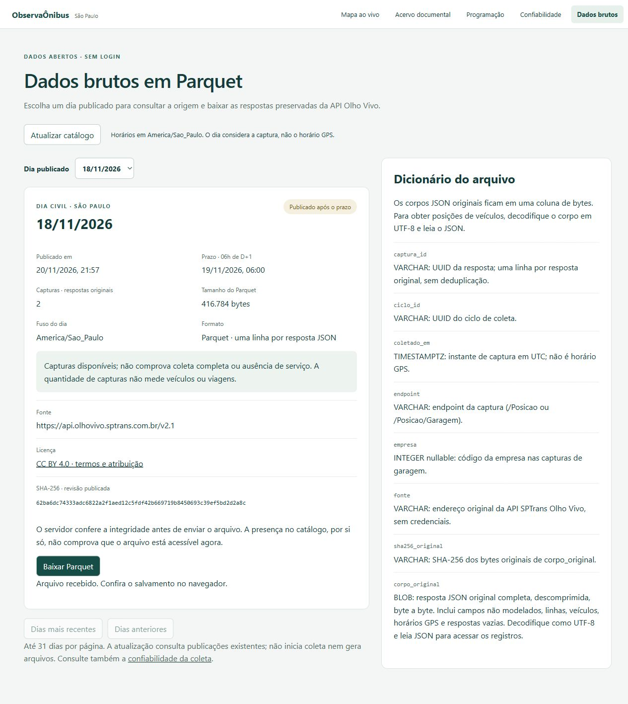
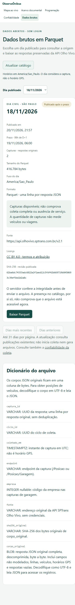
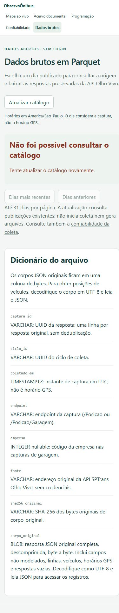

# Consulta e download de Parquet no frontend

Validação de 20/11/2026, America/Sao_Paulo. Task
[US09 — consultar dias e baixar brutos](https://trello.com/c/FNmAxSur), vinculada à
[história US09](https://trello.com/c/R1IJCY3a). Branch `us09-parquet-frontend`,
base `408036d3ecf0b0ba6a02837c1fe6527f4c1e5dc8`. O gerador do ensaio usou esse
commit completo, obtido de `git rev-parse HEAD`.

## Resultado e alcance

A navegação pública abre `#dados-brutos`, consulta dias publicados e permite
selecionar a revisão e baixar o Parquet. Metadados e dicionário ficam acessíveis
antes do download. Estados de carregamento, catálogo vazio, falha, cancelamento,
nova tentativa e mudança de revisão têm tratamento próprio.

O ensaio real usou **reimportação de duas respostas JSON preservadas da Olho
Vivo**, em banco e bucket separados do ambiente principal. Não foi uma nova
coleta ao vivo. O horário histórico de captura veio dos nomes dos arquivos UTC,
coerentes com seus metadados locais de gravação; não veio do horário GPS. Os
ciclos foram identificados como `historical_replay`, com motivo
`timestamp_from_original_filename`, sem declarar sucesso de coleta integral.

O catálogo principal tinha 25 capturas históricas de outro ciclo, com inbox já
limpa. As referências não puderam ser baixadas no S3 local atual (`ClientError`).
Esses registros não foram substituídos nem reinterpretados como disponíveis. Os
dois arquivos preservados usados neste ensaio não são as 25 capturas desse ciclo.
O reparo daquele acervo e a demonstração da coleta atual continuam pendentes;
nenhuma medição de prazo diário foi homologada.

## Fonte e processamento

Originais locais preservados, sem incluí-los no Git:

| Arquivo real | Bytes | SHA-256 dos bytes originais |
| --- | ---: | --- |
| `posicao-20261118T180221Z.json` | 1.231.449 | `74a3ad2d2a7dcf5fc6344704a417dd5d4e4d76076221ab4320077d275a153a36` |
| `posicao-20261118T184233Z.json` | 1.266.489 | `fec595cf022a7446d78c8cca0a406b65fdf7851fe34f9411511494bd66d28f19` |

Fonte declarada: SPTrans/API Olho Vivo, endpoint `/Posicao`. Capturas históricas
identificadas pelos nomes como 18/11/2026 às 18:02:21 e 18:42:33 UTC. Estes horários
não certificam continuidade da coleta entre as capturas.

Os bytes foram reintroduzidos pelo `PostgresStore`, com processamento real de
posições, arquivados pelo `ArchiveService` em JSON.gz imutável e publicados pelo
`ExportService`, com manifesto e referências reais. O banco isolado
`amarelo_us09_validation` e o bucket `us09-validation` não receberam registros
fictícios de publicação. O publicador automático foi iniciado com `--watch` e
`APP_CODE_VERSION` igual ao commit base; essa execução sem novos dias pendentes
não comprova cumprimento diário do prazo.

Resultado publicado manualmente às **21:57:47 de 20/11/2026**, horário de São Paulo:

| Campo | Resultado |
| --- | --- |
| Dia civil das capturas | 18/11/2026, America/Sao_Paulo |
| Capturas / linhas do Parquet | 2 / 2 |
| Tamanho | 416.784 bytes |
| SHA-256 do Parquet | `62ba6dc74333adc6822a2f1aed12c5fdf42b669719b8450693c39ef5bd2d2a8c` |
| Esquema | `raw-responses-parquet-v1` |
| Licença nos metadados | CC BY 4.0 |
| Prazo mostrado | 19/11/2026 às 06:00; publicação após o prazo |

O download foi iniciado pelo botão da tela no navegador e salvo como
`brutos-2026-11-18.parquet`. O arquivo salvo foi aberto com PyArrow e conferido:
hash e tamanho iguais ao catálogo, oito colunas iguais ao dicionário da API,
metadados de dia/fuso/licença corretos, duas linhas e hashes individuais dos
corpos originais iguais aos arquivos preservados. Os originais permaneceram
intactos. As oito colunas são as documentadas em
[conteúdo e dicionário](../publicacao-brutos.md#conteúdo-e-dicionário).

## Roteiro no navegador e reinício

1. Abrir a tela pública, selecionar 18/11/2026 e conferir os metadados e o aviso
   de cobertura parcial antes de baixar.
2. Baixar pelo botão e conferir o arquivo salvo conforme descrito acima.
3. Reiniciar a API e o publicador isolados: o catálogo preservou o mesmo dia,
   hash, quantidade e publicação, provenientes do PostgreSQL/S3.
4. Parar somente a API isolada. Uma tentativa de download mostrou arquivo
   indisponível; atualizar o catálogo mostrou falha de consulta sem apresentar o
   resultado antigo como atual.
5. Religar a API e atualizar: o dia reapareceu. Conferir navegação para
   Programação e retorno a Dados brutos.
6. Conferir desktop de 1280 × 900 e celular de 390 × 844: controles acessíveis,
   hashes quebrando linha e ausência de transbordamento horizontal (conteúdo
   de 375 px para viewport de 390 px, com barra de rolagem vertical).

O reinício validado foi da API/publicador, com banco e S3 mantidos disponíveis.
Não foi feita restauração nem validada a durabilidade do LocalStack após seu
próprio reinício. Em implantação, o S3 precisa conservar os bytes e versões
referenciados. A rotina reproduzível e seus comandos continuam centralizados em
[operação automática](../publicacao-brutos.md#operação-automática).

## Verificações automáticas

- `npm test`: 83 testes aprovados, incluindo dez novos testes (nove de dados
  brutos e um de navegação).
- `npm run lint --workspace @amarelo/web`: aprovado.
- `npm run build`: aprovado, incluindo TypeScript.
- `git diff --check`: aprovado.

Os novos testes cobrem seleção, metadados, paginação com limite e cursor reais,
vazio distinto de falha, resposta antiga após atualização, recuperação
independente do dicionário, salvamento por ação explícita, falha/repetição,
cancelamento e rejeição de revisão/tipo/tamanho divergentes. As respostas dos
testes unitários são sintéticas; não foram usadas como evidência dos dados reais.

API, contrato gerado e migrações não foram alterados. Testes completos do backend
ficam a cargo da CI do PR; o ensaio real exercitou armazenamento, publicação e
download existentes. Revisão técnica e merge cabem a outro desenvolvedor; esta
evidência não registra aceite do PO nem conclusão da tarefa em Done.
